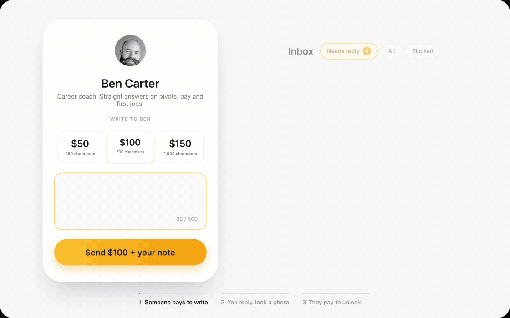

# Hotly

**Premium conversations for one creator, on your own server.** A self-hosted inbox where fans pay to send a note or subscribe weekly, and the creator replies with text, photos or video, free or paid to unlock. Payments go straight to your Stripe account, with no commission on top of Stripe's fees. Apache 2.0.

Go · Next.js · PostgreSQL 18 · Caddy · Garage (S3) · Docker Compose

- **See it:** [hotly.com](https://hotly.com/?utm_source=github&utm_medium=readme&utm_campaign=os-launch)
- **Run it:** [production install](#production) on a 2 vCPU / 4 GB Linux VPS
- **Don't want a server?** [We host it](https://hotly.com/pricing?utm_source=github&utm_medium=readme&utm_campaign=os-launch) from $5.99/mo + 20%, 30 days free



## Try it locally

Linux or macOS with Docker Engine, Compose v2, and at least 2 CPUs and 4 GB of RAM for Docker.

```bash
git clone https://github.com/designAtHotly/hotly-os.git && cd hotly-os
./scripts/install.sh --local --skip-firebase --skip-stripe --skip-sendgrid --yes
```

Open [http://localhost](http://localhost). It boots with no accounts. To add one, re-run `./scripts/install.sh --local` and paste the keys. Each one turns on a piece:

| Add | What turns on |
| --- | --- |
| Nothing | Public creator page, with checkout off |
| Stripe test keys, plus `stripe listen --forward-to localhost/api/webhooks/stripe` | Checkout, with card `4242 4242 4242 4242` |
| Firebase | Google sign-in: the creator inbox at `/dashboard`, and members of the `/dome` community |
| SendGrid | Email: reply and payment notices, guest sign-in recovery |

Running it for real? The [production install](#production) pins a release tag. [Read the installer](scripts/install.sh) first, it's one file.

## Before you commit

- **One creator per install, on purpose.** One Stripe account, one inbox, a simple data model. For several creators, run one install each.
- **Your accounts, your data.** Postgres and media live in Docker volumes on your box, and fans pay your Stripe account directly. The running app has no telemetry or analytics. Email logos load from hotly.com.
- **Three outside services.** Stripe, Firebase (Google sign-in only) and SendGrid (email only).
- **No prebuilt images yet.** It builds from source, which is why the box needs 4 GB.
- **Maintained by the Hotly team.** Tagged releases about once a month; pin one. Go tests and type checks run in CI. Built by humans, assisted by AI.
- **How this gets paid for.** [Hosted Hotly](https://hotly.com/pricing?utm_source=github&utm_medium=readme&utm_campaign=os-launch) pays for maintenance. Self-hosting stays free.
- **A real creator, on the hosted version.** [Bailey Schildbach](https://hotly.com/schildba?utm_source=github&utm_medium=readme&utm_campaign=os-launch) banked $22,400 in her first 60 days on hosted Hotly, including brand deals. This repo is the single-creator, self-hosted build of that product.

## Prerequisites

You supply the machine, DNS, and accounts. This project does not create a VPS, a domain, Docker, or Firebase / Stripe / SendGrid. Operators **build images from source**. There are no published prebuilt images.

### Linux VPS

Production is a Linux virtual machine you can SSH into. **Windows is not supported** (not as a server, and local Docker Desktop on Windows is not a supported host). Try the stack locally on Linux or macOS.

If you build images on the box (the documented path): **2 vCPU and at least 4 GB RAM**. Typical cloud images have no swap. A 2 GB machine is too tight for `docker compose up --build`. Put the VM in a region close to the creator and the guests you expect — every page and upload is a round trip to this host.

Enable the provider’s automatic backups or disk snapshots. That is not enough by itself: PostgreSQL and media live in Docker volumes on that disk. Still run [`docs/operations.md`](docs/operations.md#backup) on a schedule and copy `.backup/` off the VPS. Losing the machine without an off-box copy means losing conversations and uploads.

Any generic Docker-capable Linux VPS works. A DigitalOcean Basic 2 vCPU / 4 GB class machine is enough. Similar: [Hetzner Cloud](https://www.hetzner.com/cloud), [Linode](https://www.linode.com/), [Vultr](https://www.vultr.com/), OVHcloud, AWS Lightsail, Google Compute Engine. You need a VM. [Render](https://render.com/), Railway, Fly, and other single-service PaaS are **not** this Compose stack.

### Docker Engine and Compose v2

On that machine you need **both**:

- Docker Engine (`docker info` reaches a running daemon)
- the Compose **v2 plugin** (`docker compose version`, with a space)

The old `docker-compose` (hyphen) binary is not enough. The installer will not install Docker or Compose for you.

On an Ubuntu/Debian VPS as root (same command we used; Engine plus Compose v2):

```bash
curl -fsSL https://get.docker.com | sh
systemctl enable --now docker
docker info
docker compose version
```

Not for macOS. Official packages: [Install Docker Engine](https://docs.docker.com/engine/install/). macOS local: [OrbStack](https://orbstack.dev/) or Docker Desktop.

### Domain and DNS

A hostname at any registrar, with access to create A/AAAA records. A raw public IP is a smoke host, not the origin guests, Google, Stripe, or recovery mail should use.

Moving the zone to [Cloudflare](https://www.cloudflare.com/) is recommended. Keep the record **DNS only** (grey cloud) until Caddy has a Let’s Encrypt certificate; orange-cloud proxy hides the origin from Let’s Encrypt.

### Accounts

Operator-owned [Firebase](https://firebase.google.com/) (Google sign-in), [Stripe](https://stripe.com/), and [SendGrid](https://sendgrid.com/). The stack boots if those keys are empty; the matching pages then say the provider is not configured.

## Host size

Bare minimum for a public VPS that builds images on the box: **2 vCPU and 4 GB RAM**. Typical cloud images have no swap.

Idle Compose is a few hundred MiB. On a 4 GB Ubuntu host, `docker compose up --build` can peak around **2.7 GB** used. A 2 GB machine is too tight for on-box Next.js + Go builds.

Disk needs room for the OS, images, PostgreSQL, and media. Media growth is the long-term limit, not RAM. Measured breakdown: [`docs/operations.md`](docs/operations.md#host-size).

## Local install details

On its own, `./scripts/install.sh --local` prompts for each provider. It fails fast if Docker is missing and does not install Docker or Bun.

Skip providers or Compose while testing: `--skip-firebase --skip-stripe --skip-sendgrid --skip-up --yes`. Below 2 vCPU / 4 GB Docker RAM the installer stops; `--skip-spec` overrides that. The "System (paste this in a GitHub issue)" block is for bug reports.

Or by hand:

```bash
cp .env.example .env
# Set CREATOR_EMAIL. Replace SESSION_SECRET, RECOVERY_TOKEN_SECRET, and Garage keys.
# Leave Firebase, Stripe, and SendGrid empty until you have those credentials.
docker compose up --build
```

Open [http://localhost](http://localhost). Health: `GET /api/health`. Browsers land on `/`. The public origin is Caddy (`/` + `/api`), not `:3000` or `:8080`.

Compose starts PostgreSQL 18, runs `db/migrations` before the API, then the Go API, Next.js, Garage (private S3), and Caddy.

## Routes

| Path | Who |
| --- | --- |
| `/` | Public landing: creator, USD prices, Checkout, “Powered by Hotly.” |
| `/penpal` | Redirects to `/` |
| `/chat` | Paid guest conversation (HTTP-only cookie after Checkout or recovery) |
| `/dome`, `/dome/:promptSlug` | Community; `#note-<id>` is a stable note fragment |
| `/dashboard` | Creator home (configured Firebase email only). `/creator` redirects here. |
| `/creator/inbox`, `/creator/dome`, `/creator/settings` | Inbox, Dome console, settings |
| `/auth/firebase` | Google sign-in |
| `/auth/chat-recovery` | Guest recovery request and consume |

USD only. Defaults: one-time notes **$5 / 250**, **$10 / 500**, **$15 / 1,000** characters (`ONE_TIME_PRICE_CENTS`, `ONE_TIME_PRICE_500_CENTS`, `ONE_TIME_PRICE_1000_CENTS`); Custom must be at least $1 above the 1,000-character price; weekly Penpal **$15** / 2,000 characters (`WEEKLY_PRICE_CENTS=1500`). Named-tier Checkout ignores browser amount and currency.

## Apps

- [`apps/web`](apps/web) — Next.js UI (Bun). Same-origin `/api` fetches with cookies. Favicon, apple-touch, android-chrome, wordmarks, and `site.webmanifest` are in `apps/web/public`.
- [`apps/server`](apps/server) — Go API (Chi, pgx, sqlc). Automated tests live here only.
- [`emails`](emails) — React Email sources for the three SendGrid bodies. `bun run emails:render`, then rebuild `server`. Details: [`emails/README.md`](emails/README.md).

There is no frontend test suite. UI is checked with `bun run check-types` / `bun run build` and by using the app.

On GitHub, pull requests, `main`, and `v*.*.*` tags run Go tests, `bun run check-types`, and `docker compose config`. Cutting a version tag publishes a GitHub Release after those checks pass.

Local apps without Compose (API still needs Postgres and the env):

```bash
bun run dev
```

## Production

Bring **DNS up before** the first public Compose. A raw droplet IP is a smoke host, not the origin guests, Google, Stripe, or recovery mail should use.

Pin a **Release tag** (`v0.1.6`), not a drifting `main`. Hostname + A/AAAA first (Cloudflare: **DNS only** until the certificate exists). 2 vCPU / 4 GB if you build on the box. TCP 80 and 443. Docker Engine and Compose v2. Then curl — do not hand-edit `.env` or run Compose yourself:

```bash
curl -fsSL https://raw.githubusercontent.com/designAtHotly/hotly-os/v0.1.6/scripts/install.sh | bash -s -- --tag v0.1.6 --github designAtHotly/hotly-os
```

That unpacks to **`~/hotly-os`**. Answer the prompts for `https://your.domain.example` (canonical origin, Open Graph, `/robots.txt`, `/sitemap.xml`). The installer writes `.env`, uses the prod overlay (Postgres / API / Next.js not published), and starts Compose. From a checkout of that tag: `./scripts/install.sh --local`.

After that, in the provider consoles: Firebase authorized domain, Stripe webhook `https://your.domain.example/api/webhooks/stripe` (Checkout, subscription, and invoice events in [`docs/operations.md`](docs/operations.md#stripe-when-you-have-keys); paste `whsec_` at the installer prompt), SendGrid API key starting `SG.` plus a verified sender ([app.sendgrid.com](https://app.sendgrid.com/settings/api_keys)).

Full sequence, backup/restore, upgrades, SendGrid vs Twilio keys: [`docs/operations.md`](docs/operations.md).

## License

Apache License 2.0. See [`LICENSE`](LICENSE) and [`NOTICE`](NOTICE).

## Community

- [`CONTRIBUTING.md`](CONTRIBUTING.md) — how to run checks and open a PR
- [`CODE_OF_CONDUCT.md`](CODE_OF_CONDUCT.md) — Contributor Covenant 2.1
- [`SECURITY.md`](SECURITY.md) — private vulnerability reports, not public issues
- [`SUPPORT.md`](SUPPORT.md) — operations vs GitHub vs provider consoles
- [`docs/github.md`](docs/github.md) — enable Private vulnerability reporting and Dependabot on this GitHub repository
